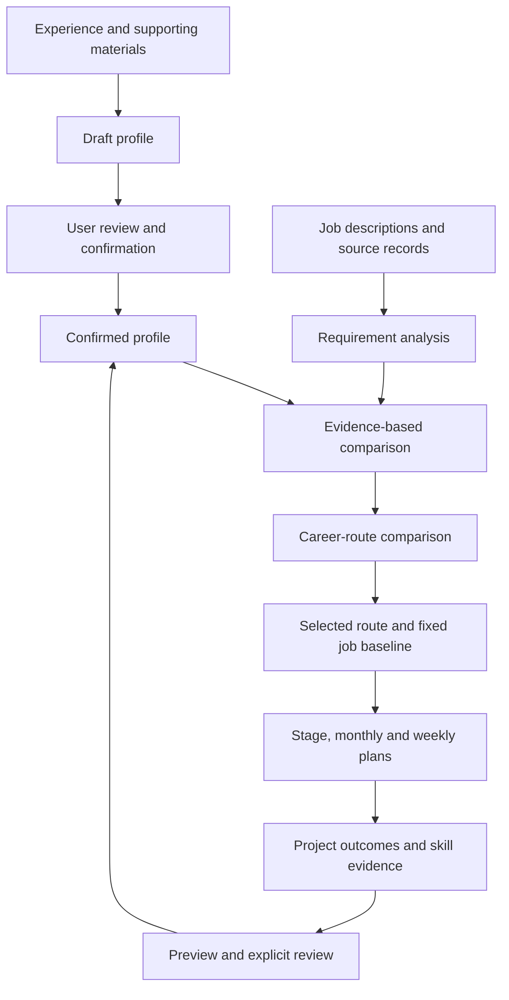

# Career Agent · Nextstep

**A local career-planning assistant for engineering students, connecting personal evidence, job requirements, and actionable learning plans.**

`Python` · `FastAPI` · `JavaScript` · `SQLite` · `Local LLM assistance`

This repository is a **public project overview**. The implementation is maintained in a separate private repository. Source code, resumes, personal profiles, job-search records, and runtime data are not distributed here.

## The problem

A job description lists requirements, but it rarely explains which gaps a student should address first or how to turn them into a realistic plan. Career Agent explores that connection: review existing experience, compare career routes, identify missing evidence, and plan work that produces demonstrable skills.

## Product workflow

## Current capabilities

| Area | Workflow |
| :--- | :--- |
| Profile | Import supporting material, review a draft, and confirm a versioned profile |
| Career exploration | Import job descriptions, compare routes, and inspect requirement-level matching explanations |
| Gap analysis | Separate explicit gaps, missing personal evidence, and requirements the system has not understood |
| Route decisions | Choose primary and secondary routes; inspect skills against a fixed job-sample baseline |
| Planning | Build stage, monthly, and weekly plans from available time and practical opportunities |
| Progress review | Submit evidence for individual skills, preview changes, and confirm updates |

The current interface is Chinese. Job-source workflows cover selected German and Chinese sources. Coverage and interpretation remain limited by the available samples and supported parsing rules.

## Engineering decisions

- **Drafts require confirmation.** Imported material and generated plans do not silently replace accepted records.
- **Unknown is a separate state.** A parsing limitation is distinguished from a skill gap or a lack of evidence.
- **Baselines stay stable.** Updating a profile can recompute against the same job sample; replacing that sample is a separate action.
- **Completed tasks do not automatically raise skill scores.** New capability claims require reviewed evidence.
- **Local assistance has a defined role.** Existing local-model assistance supports selected material/import workflows. Experimental semantic job-description parsing is not presented as the production matching engine.

## Technical overview

| Layer | Implementation approach |
| :--- | :--- |
| Backend | Python and FastAPI, running as one local process |
| Interface | Native HTML, JavaScript, and CSS served by the backend |
| Persistence | Local SQLite and JSON records |
| Matching | Requirement parsing, evidence checks, explicit uncertainty, and versioned recomputation |
| Development | Specification-based changes, Python tests, and frontend tests |

## Example journey

*Illustrative scenario, not personal data:* an engineering student compares software and robotics roles. They review why a job requires a particular skill, distinguish a missing skill from missing evidence, and choose a project for their available time. Completing the project produces evidence for review; it does not automatically establish every qualification in the job description.

## Status and limits

This is an actively developed personal application. The reviewed project documentation identifies V5.4.0 as the released baseline on 2026-11-04; this public overview was prepared on 2026-11-06.

- The application is designed for local single-user use. Multi-user authentication and public hosting are not provided by this showcase.
- Matching scores estimate requirement coverage in the available sample. They are not hiring probabilities.
- Complex job-description conditions can be missed or misinterpreted; full interpretation accuracy has not been independently validated.
- Career Coach is a prototype entry point, not a completed cross-page assistant.
- This documentation-only repository cannot be installed or run, and it does not report a fresh application test run.

## Connect

[GitHub · Kylie08ky](https://github.com/Kylie08ky) · [Email](mailto:kylie.ky937323@gmail.com)
